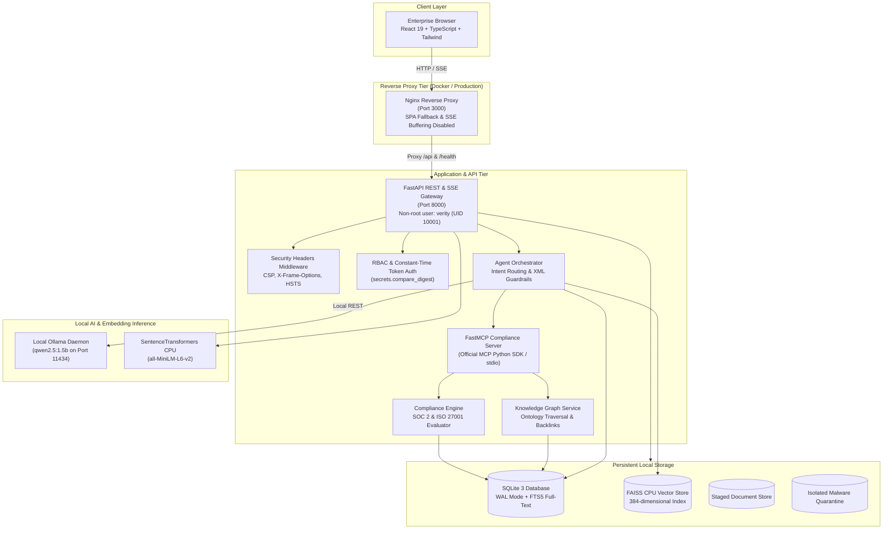

# VERITY — Enterprise Document Intelligence & Compliance Agent

[](https://fastapi.tiangolo.com)
[](https://react.dev)
[](https://modelcontextprotocol.io)
[-black.svg)](https://ollama.ai)
[](#)

> **VERITY** is a local-first, zero-cloud-cost enterprise document intelligence and compliance audit agent. Built for rigorous enterprise security evaluations, VERITY ingests multi-format enterprise documentation (PDF, DOCX, TXT), performs hybrid dense vector and sparse lexical retrieval, executes evidence-grounded agent reasoning via genuine FastMCP tools, and evaluates regulatory compliance frameworks (SOC 2 Type II, ISO/IEC 27001:2022).

---

## Key Highlights

- **Zero Cloud Cost & Data Privacy ($0.00 / month)**: 100% on-premises execution using local Ollama (`qwen2.5:1.5b` Q4_K_M) and CPU-accelerated `sentence-transformers` (`all-MiniLM-L6-v2`). No enterprise documents or query prompts ever leave the local network.
- **Official Model Context Protocol (MCP)**: Implements genuine FastMCP server and MCP client over asynchronous `stdio` process pipes. Tools are dynamically discovered, allowlisted, and executed with strict timeout boundaries.
- **Hybrid Retrieval Architecture**: Dense vector similarity (FAISS CPU, 384 dimensions) fused with sparse BM25 keyword matching (SQLite FTS5) via Reciprocal Rank Fusion ($k=60$).
- **Evidence-Grounded Citations**: AI responses are bounded by XML evidence envelopes. Every citation is referentially and cryptographically verified against ground truth document chunks in SQLite with structural locators (Page, Section, Paragraph).
- **Automated Compliance Engine**: Automated control mapping, gap analysis, and historical regression tracking across SOC 2 and ISO 27001 standards.
- **Knowledge Graph Traversal**: Relational regulatory ontology linking compliance frameworks, controls, policies, and evidence chunks with multi-hop graph exploration.
- **Enterprise Defense & Malware Isolation**: Fail-closed upload validation featuring magic byte inspection, decompression bomb (ZIP-bomb) defense, path traversal sanitization, and automated quarantine isolation for threats (EICAR, Windows Defender, ClamAV).
- **Executive React 19 Dashboard**: Built with React 19, TypeScript, Tailwind CSS, Lucide icons, and Recharts, featuring real-time Server-Sent Events (SSE) streaming.

---

## System Architecture



---

## Directory Structure

```
.
├── .dockerignore                       # Docker root build exclusions
├── .env.example                        # Development environment template
├── .env.production.example             # Production environment template
├── .gitignore                          # Comprehensive Git exclusions
├── Dockerfile                          # Hardened non-root backend container image
├── docker-compose.yml                  # Multi-service production deployment
├── main.py                             # Production ASGI application entrypoint
├── pyproject.toml                      # Python dependency definitions & tool configuration
├── requirements.txt                    # Pinned Python package dependencies
├── README.md                           # Project documentation & overview
│
├── data/                               # Local persistent storage volumes
│   ├── benchmark_results.json          # Empirical performance benchmark records
│   ├── faiss/                          # Serialized FAISS index (.gitkeep)
│   ├── quarantine/                     # Isolated infected file storage (.gitkeep)
│   ├── sqlite/                         # SQLite database with FTS5 (.gitkeep)
│   └── uploads/                        # Staged document uploads (.gitkeep)
│
├── docs/                               # System documentation & architectural reports
│   ├── agent-workflow.md               # 8-stage bounded agent lifecycle
│   ├── api-reference.md                # Comprehensive REST API endpoint reference
│   ├── architecture.md                 # Complete system architecture specification
│   ├── cost-approach.md                # Zero-cost TCO analysis and hardware budgeting
│   ├── database-schema.md              # SQLite schema, FTS5 triggers, and ER diagrams
│   ├── deployment-guide.md             # Operations runbook, Docker & bare-metal guide
│   ├── end-to-end-testing.md           # 12 end-to-end integration workflows report
│   ├── final-security-audit.md         # Comprehensive security audit & threat model
│   ├── frontend-architecture.md        # React 19 UI component & state design
│   ├── knowledge-management.md         # Regulatory ontology & graph traversal
│   ├── mcp-tools.md                    # FastMCP tool contracts & JSON-RPC protocols
│   └── phase-4-report.md               # Phase 4 delivery summary & performance tables
│
├── frontend/                           # React 19 TypeScript Dashboard
│   ├── Dockerfile                      # Multi-stage production Nginx container
│   ├── nginx.conf                      # Reverse proxy & SSE buffering configuration
│   ├── package.json                    # Frontend dependencies & scripts
│   ├── src/
│   │   ├── api/                        # Axios HTTP client & central TypeScript interfaces
│   │   ├── components/                 # Reusable UI widgets, charts, and drawers
│   │   ├── context/                    # AuthContext and ToastContext providers
│   │   ├── pages/                      # Assistant, Compliance, Documents, Graph, etc.
│   │   └── services/                   # Service integration layer & SSE client
│   └── vite.config.ts                  # Vite build & Vitest test configuration
│
├── scripts/                            # Automation & operational utilities
│   ├── benchmark_performance.py        # Hardware profiling & resource benchmark
│   ├── pull_model.py                   # Portable Python Ollama model puller
│   ├── pull_model.ps1                  # PowerShell model download helper
│   ├── setup_ollama.ps1                # PowerShell Ollama environment setup
│   └── start_ollama.ps1                # PowerShell Ollama background daemon launcher
│
├── src/                                # Python Backend Architecture
│   ├── agent/                          # Bounded Agent Orchestration
│   │   ├── evidence_validator.py       # Referential & SHA-256 citation verifier
│   │   ├── execution_engine.py         # MCP tool dispatcher with step budgeting
│   │   ├── guardrails.py               # Prompt injection defense & XML envelope containment
│   │   ├── intent_router.py            # Rule & semantic task intent classifier
│   │   ├── mcp_client.py               # Async MCP Client over STDIO subprocess
│   │   ├── orchestrator.py             # 8-stage lifecycle coordinator
│   │   ├── planner.py                  # Initial & iterative execution planner
│   │   └── response_generator.py       # Grounded answer synthesis with deterministic fallback
│   ├── api/                            # FastAPI REST & SSE Gateway
│   │   ├── app.py                      # Application factory & lifespan handlers
│   │   ├── config.py                   # Pydantic Settings & environment validation
│   │   ├── dependencies.py             # Dependency injection singletons
│   │   ├── middleware/                 # Security headers, logging, and error envelopes
│   │   ├── routers/                    # Health, Documents, Search, Chat, Compliance, Knowledge
│   │   └── security/                   # Constant-time auth, RBAC, and file security
│   ├── compliance/                     # Compliance Intelligence Engine
│   │   ├── engine.py                   # Multi-framework compliance coordinator
│   │   ├── assessment.py               # Framework assessment scoring & gap analyzer
│   │   ├── gap_analyzer.py             # Control gap detector & impact categorizer
│   │   └── remediation.py              # Prioritized remediation roadmap generator
│   ├── indexing/                       # Hybrid Ingestion & Search Core
│   │   ├── chunker.py                  # Token-aware sliding chunker with paragraph locators
│   │   ├── embedding_service.py        # SentenceTransformers embedding service
│   │   ├── hybrid_search.py            # FAISS + FTS5 Reciprocal Rank Fusion engine
│   │   └── ingestion_pipeline.py       # Deduplication, parsing, chunking, and indexing
│   ├── knowledge/                      # Knowledge Graph & Backlinks
│   │   ├── graph_service.py            # Ontology query service
│   │   └── graph_traversal.py          # Multi-hop relational graph crawler
│   ├── mcp_server/                     # Genuine FastMCP Official Server
│   │   ├── server.py                   # FastMCP instance & STDIO entrypoint
│   │   └── tools/                      # Official MCP tool implementations
│   ├── parsers/                        # Hardened Document Parsers
│   │   ├── docx_parser.py              # OpenXML parser with ZIP-bomb defense
│   │   ├── pdf_parser.py               # PyMuPDF passive text parser with page bounds
│   │   └── txt_parser.py               # Plain text & encoding validator
│   └── storage/                        # Persistence Layer
│       ├── db.py                       # SQLite connection pool, migrations, and FTS5 triggers
│       ├── faiss_store.py              # FAISS index persistence & ID mapping
│       └── seed_data.py                # Baseline SOC 2 & ISO 27001 data seeder
│
└── tests/                              # Pytest Comprehensive Test Suite
    ├── conftest.py                     # Session-scoped test fixtures
    ├── test_agent.py                   # Agent orchestration & prompt guardrail tests
    ├── test_api.py                     # API router endpoint & RBAC tests
    ├── test_chat_streaming_regression.py # SSE streaming event sequence & citation tests
    ├── test_compliance_and_knowledge.py# Compliance evaluation & graph traversal tests
    ├── test_e2e_integration.py         # 12 Full-Stack integration workflows
    ├── test_faiss_store.py             # Vector store persistence & search tests
    ├── test_ingestion_and_hybrid_search.py # Ingestion pipeline & RRF fusion tests
    ├── test_mcp_server_stdio.py        # Real STDIO MCP protocol handshake tests
    ├── test_mcp_tools_unit.py          # MCP tool execution unit tests
    ├── test_parsers.py                 # Multi-format parser & bomb limit tests
    └── test_storage.py                 # SQLite WAL & FTS5 trigger verification tests
```

---

## Quickstart Guide

### 1. Prerequisites
- **Python**: 3.11 or newer (installed with `uv` recommended)
- **Node.js**: 20 LTS and npm 10+
- **Ollama**: Running locally with `qwen2.5:1.5b` (`ollama pull qwen2.5:1.5b`)

### 2. Local Native Execution (Windows / Linux / macOS)

**Terminal 1 — Launch Ollama:**
```bash
ollama serve
```

**Terminal 2 — Start FastAPI Backend:**
```powershell
# Windows PowerShell
.venv\Scripts\uvicorn main:app --reload --port 8000

# Linux / macOS
source .venv/bin/activate
uvicorn main:app --reload --port 8000
```
- API Documentation (Swagger): [http://localhost:8000/docs](http://localhost:8000/docs)
- Health Probe: [http://localhost:8000/health](http://localhost:8000/health)

**Terminal 3 — Start React 19 Frontend:**
```bash
cd frontend
npm install
npm run dev
```
- Dashboard UI: [http://localhost:5173](http://localhost:5173)

---

### 3. Containerized Deployment (Docker Compose)

```bash
# 1. Prepare production environment variables
cp .env.production.example .env

# 2. Build and launch services
docker compose up -d --build
```
- Web UI: [http://localhost:3000](http://localhost:3000)
- Backend API: [http://localhost:8000](http://localhost:8000)

---

## Authentication & Role-Based Access Control (RBAC)

Requests are authenticated using the `X-API-Key` header or `Authorization: Bearer <key>`. Tokens are evaluated using constant-time string comparison (`secrets.compare_digest`) to prevent timing side-channel attacks.

| Role | Default Development Key | Permissions |
| :--- | :--- | :--- |
| **Admin** | `verity-admin-secret-key` | Full read, write, upload, delete, compliance evaluation, and audit log access. |
| **Auditor** | `verity-auditor-secret-key` | Read-only access to documents + authority to run compliance audits and gap analyses. |
| **User** | `verity-user-secret-key` | Standard search, document inspection, and natural language chat inquiries. |

---

## Official Model Context Protocol (MCP) Tools

VERITY exposes 7 official FastMCP tools over standard I/O:

| Tool Name | Parameters | Description |
| :--- | :--- | :--- |
| `list_documents` | `limit`, `offset` | Enumerate ingested documents with hashes and metadata. |
| `search_documents` | `query`, `top_k`, `framework_filter` | Execute dense vector + FTS5 BM25 hybrid search with RRF fusion. |
| `get_document_metadata`| `document_id` | Retrieve comprehensive document properties and structural chunks. |
| `get_citation` | `chunk_id` | Retrieve verbatim excerpt and verify referential integrity. |
| `evaluate_compliance` | `framework_id`, `requirement_id` | Score evidence coverage against SOC 2 or ISO 27001 requirements. |
| `gap_analysis` | `framework_id` | Identify unaddressed controls and prioritize remediation tasks. |
| `get_related_knowledge`| `node_id`, `max_depth` | Traverse relational regulatory ontology links and parent-child concepts. |

---

## Performance & Hardware Benchmarks

Profiled on an **11th Gen Intel Core i5-11400F CPU @ 2.60GHz (6 Cores / 12 Threads) with 7.84 GB RAM**:

| Benchmark Metric | Measured Result | Benchmark Standard |
| :--- | :--- | :--- |
| **Application Cold Startup** | **1,662.73 ms** | < 3,000 ms |
| **Frontend Production Bundle** | **863.8 KB** (253.2 KB Gzip) | < 1.5 MB |
| **Document Ingestion Throughput**| **597.02 ms** / chunk (Scan + Chunks + Embed + Index) | < 1,000 ms / chunk |
| **Hybrid Search Latency (p50)** | **22.21 ms** (Dense FAISS + Sparse FTS5 Fusion) | < 100 ms |
| **Hybrid Search Latency (p95)** | **25.86 ms** | < 250 ms |
| **API Endpoint `/health`** | **4.35 ms** | < 50 ms |
| **API Endpoint `/ready`** | **1,530.51 ms** (Database + Vector Store + Ollama) | < 2,500 ms |
| **Compliance Evaluation API** | **82.54 ms** | < 500 ms |
| **Concurrent Throughput** | **80.84 req/s** (10 concurrent workers, 100% success) | > 25 req/s |
| **Peak Working Set Memory** | **608.12 MB RSS** (+138.5 MB delta during peak inference) | < 1,024 MB |

---

## Security Verification & Supply Chain Integrity

- **Zero Known Vulnerabilities**: Verified through `pip-audit` (0 CVEs across all Python packages) and `npm audit` (0 vulnerabilities across 259 frontend packages).
- **Fail-Closed Antivirus**: Ingested files are validated for magic byte signatures, scanned against EICAR patterns, and isolated in `data/quarantine/` upon suspicion.
- **Decompression Bomb Defense**: DOCX OpenXML packages are pre-inspected for max entries (≤2000), max uncompressed size (≤100 MB), and compression ratios (≤100x).
- **PDF Resource Guards**: PDF documents enforce page limits (`MAX_PDF_PAGES = 1000`) and passive text extraction to prevent denial-of-service memory exhaustion.
- **Prompt Injection Defense**: Adversarial heuristic detectors and strict XML CDATA boundary encapsulation (`<document_evidence_block>`) isolate untrusted document text.
- **Container Hardening**: Backend runs as an unprivileged non-root user (`verity`, UID 10001). Secrets are strictly excluded from Docker build layers.

---

## Test Execution

```bash
# Run End-to-End Integration Tests (12 workflows)
uv run pytest tests/test_e2e_integration.py -v

# Run Chat Streaming Regression Tests
uv run pytest tests/test_chat_streaming_regression.py -v

# Run Complete Backend Test Suite (127+ tests)
uv run pytest -v

# Run Frontend Unit Tests (Vitest)
npm test --prefix frontend

# Run Frontend Production Build
npm run build --prefix frontend
```

---

## Assessment Declaration

This codebase was developed as a technical assessment prototype for the **VEGAH Enterprise Document Intelligence & Compliance Agent** role. All architectural designs, MCP server integrations, hybrid retrieval algorithms, compliance engines, and user interfaces are original implementations fulfilling the technical specifications.

