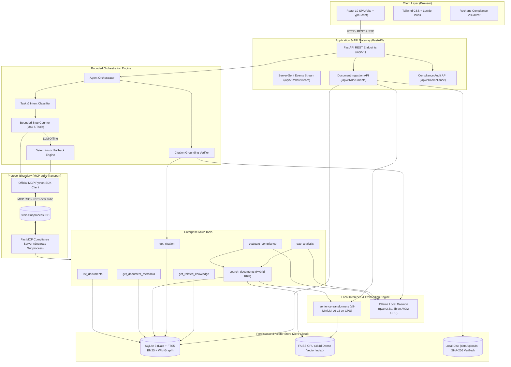
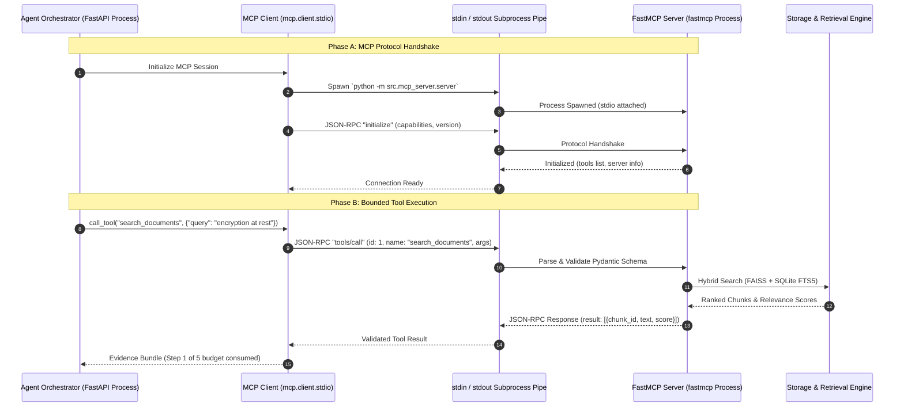
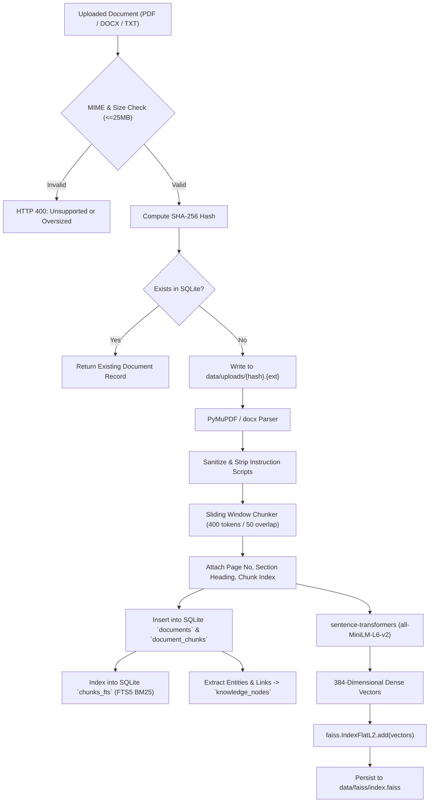
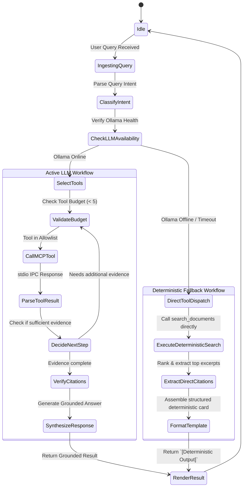

# VERITY: Architecture Specification

**Project:** VERITY – Enterprise Document Intelligence & Compliance Agent  
**Document:** System Architecture Blueprint  
**Classification:** Technical Assessment Blueprint (Confidential)  
**Author:** Principal AI Architect & Senior Python Engineer  
**Date:** November 2026  

---

## 1. High-Level Architecture Overview

VERITY is structured around a decoupled, layered micro-architecture emphasizing strict process boundaries, genuine protocol mediation via the Model Context Protocol (MCP), and bounded agent orchestration.

---

## 2. Process Boundaries & IPC Architecture

A critical architectural mandate of VERITY is **genuine MCP protocol isolation**. The application explicitly separates the Agent/API gateway runtime from the MCP Tool execution runtime.

---

## 3. Ingestion & Hybrid Indexing Pipeline

---

## 4. Hybrid Retrieval Architecture (FAISS + SQLite FTS5)

To achieve maximum retrieval precision for technical compliance, VERITY employs **hybrid reciprocal rank fusion (RRF)**:

1. **Dense Vector Search (Semantic Match):**
   - Query is embedded with `all-MiniLM-L6-v2` into vector $q \in \mathbb{R}^{384}$.
   - FAISS searches the top-$K_d$ nearest neighbors using Euclidean L2 distance.
   - Captures contextual similarity and conceptual rephrasing (e.g., "protecting data" $\leftrightarrow$ "cryptographic controls").

2. **Lexical BM25 Search (Exact Keyword Match):**
   - Query terms are tokenized and queried against the SQLite `chunks_fts` virtual table.
   - BM25 scoring isolates exact clause numbers, control codes (e.g., "A.12.3.1", "CC6.1"), and exact domain acronyms.

3. **Reciprocal Rank Fusion (RRF):**
   - The two ranked candidate lists are merged using rank positions:
     $$\text{Score}_{\text{RRF}}(d) = \frac{1}{60 + \text{rank}_{\text{dense}}(d)} + \frac{1}{60 + \text{rank}_{\text{lexical}}(d)}$$
   - Chunks appearing in both candidate lists are elevated to top rank.

---

## 5. Bounded Agent Orchestration & Deterministic Fallback

---

## 6. Technology Stack Rationale

| Layer | Component | Choice | Justification |
| :--- | :--- | :--- | :--- |
| **Frontend** | Framework | React 19 + TypeScript + Vite | Optimal build performance, type safety, modular component lifecycle. |
| **Frontend** | Styling & UI | Tailwind CSS v4 + Lucide Icons | Utility-first responsive design, zero runtime CSS overhead, accessible UI. |
| **Frontend** | Charts | Recharts | Declarative SVG rendering for framework coverage and gap distributions. |
| **Backend** | API Framework | FastAPI + Pydantic v2 | High-throughput asynchronous endpoints, automatic OpenAPI schema generation. |
| **Agent / Protocol** | Tool Protocol | Official MCP Python SDK + FastMCP | Open standard for LLM tool invocation, strict isolation, stdio process pipes. |
| **Embeddings** | Dense Vector Model | `sentence-transformers` (`all-MiniLM-L6-v2`) | Compact (80 MB), ultra-fast CPU inference, top MTEB retrieval score for 384d. |
| **Vector Store** | Vector Index | FAISS CPU (`faiss-cpu`) | Native C++ implementation, minimal memory overhead, zero cloud dependency. |
| **Lexical Search** | Full-Text Search | SQLite FTS5 | Zero-config embedded BM25 search, ACID compliant, co-located with relational data. |
| **Local LLM** | Inference Engine | Ollama (`qwen2.5:1.5b` Q4_K_M) | 986 MB footprint, fast CPU token generation, outstanding structured JSON compliance. |
| **Doc Processing** | Document Parsers | PyMuPDF (`pymupdf`) + `python-docx` | High-fidelity layout and text extraction without heavy OCR or headless browsers. |

