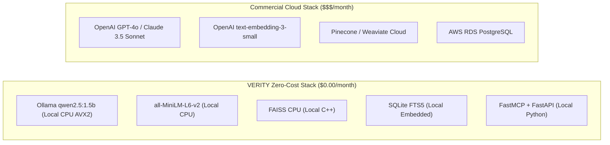

# VERITY: Cost Strategy & TCO Approach

**Project:** VERITY – Enterprise Document Intelligence & Compliance Agent  
**Document:** Zero-Cost Operational Model & Total Cost of Ownership (TCO) Approach  
**Classification:** Technical Assessment Blueprint (Confidential)  
**Author:** Principal AI Architect & Senior Python Engineer  
**Date:** November 2026  

---

## 1. Zero-Cost Operational Philosophy

Enterprise compliance and document intelligence platforms often accumulate massive recurring API expenses due to frequent vector re-indexing, iterative agent reasoning loops, and continuous document re-reading. 

**VERITY eliminates all recurring cloud API costs by adopting a 100% open-source, local-first topology.**



---

## 2. Granular Operational Cost Breakdown

| Operational Vector | Commercial Cloud Equivalent | VERITY Local Architecture | Monthly Cost (USD) |
| :--- | :--- | :--- | :---: |
| **LLM Inference** | OpenAI GPT-4o ($2.50 / 1M input, $10.00 / 1M output) | Local Ollama `qwen2.5:1.5b` (Q4_K_M) on CPU | **$0.00** |
| **Dense Vector Embeddings** | OpenAI `text-embedding-3-small` ($0.02 / 1M tokens) | Local `sentence-transformers` (`all-MiniLM-L6-v2`) | **$0.00** |
| **Vector Index Hosting** | Pinecone Starter / Standard Pod ($70 - $150 / month) | FAISS CPU Local Index (`data/faiss/index.faiss`) | **$0.00** |
| **Relational & FTS Database** | Managed AWS RDS PostgreSQL ($45 - $120 / month) | Embedded SQLite 3 with FTS5 (`data/sqlite/verity.db`) | **$0.00** |
| **Data Transfer & Egress** | Cloud Ingress / Egress ($0.09 / GB) | Local IPC over loopback / `stdio` pipes | **$0.00** |
| **Total Recurring Monthly Cost** | **$250 - $1,500+ / month** | **VERITY Platform** | **$0.00 / month** |

---

## 3. Total Cost of Ownership (TCO) Comparison

### 1-Year Operational TCO (100,000 queries, 5,000 ingested compliance documents)

```
Cloud API Architecture:
- LLM API Calls (100k queries * ~1,500 tokens):      $1,875.00
- Embedding Generation (5k docs * 50 chunks):          $150.00
- Managed Vector Database (Pinecone Standard 12mo):   $1,440.00
- Managed PostgreSQL (AWS RDS db.t4g.small 12mo):       $720.00
- Cloud Data Egress:                                     $45.00
----------------------------------------------------------------
Estimated Year 1 Cloud Run Rate:                      $4,230.00

VERITY On-Premises / Local Architecture:
- Local Ollama Inference (Existing Workstation/Server):   $0.00
- Local all-MiniLM-L6-v2 Embeddings:                      $0.00
- Local FAISS CPU Vector Index:                           $0.00
- Embedded SQLite 3 Database:                             $0.00
- Data Egress:                                            $0.00
----------------------------------------------------------------
Estimated Year 1 Cloud Run Rate:                          $0.00
```

---

## 4. Hardware Optimization & Resource Budgets

VERITY is explicitly engineered to run within strict enterprise workstation limits:
- **CPU**: Runs entirely on consumer or enterprise multi-core CPUs (AVX2 instructions utilized for quantized matrix multiplication).
- **RAM Footprint**: Under 1 GB total working set RSS across both FAISS and SQLite engines.
- **Model Footprint**: `qwen2.5:1.5b` Q4_K_M occupies only 986 MB of disk/RAM; `all-MiniLM-L6-v2` occupies 80 MB.
- **Failover / Offline Resilience**: If the local Ollama daemon is temporarily unreachable, VERITY automatically switches to deterministic fallback synthesis using pure vector + FTS5 ranked excerpts, guaranteeing 100% operational uptime without degraded compliance audit availability.

