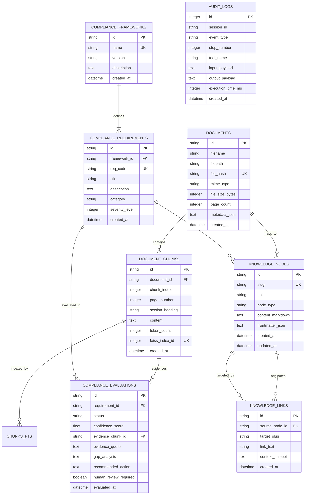

# VERITY: Database Schema Specification

**Project:** VERITY – Enterprise Document Intelligence & Compliance Agent  
**Document:** SQLite Relational & Full-Text Schema Design  
**Classification:** Technical Assessment Blueprint (Confidential)  
**Author:** Principal AI Architect & Senior Python Engineer  
**Date:** November 2026  

---

## 1. Relational Entity-Relationship Diagram



---

## 2. Table Specifications & DDL Definitions

### 2.1 Table: `documents`
Stores metadata and cryptographic hashes for all ingested enterprise files.

```sql
CREATE TABLE IF NOT EXISTS documents (
    id TEXT PRIMARY KEY,
    filename TEXT NOT NULL,
    filepath TEXT NOT NULL,
    file_hash TEXT NOT NULL UNIQUE, -- SHA-256 cryptographic digest
    mime_type TEXT NOT NULL,
    file_size_bytes INTEGER NOT NULL,
    page_count INTEGER NOT NULL DEFAULT 1,
    metadata_json TEXT DEFAULT '{}',
    created_at TIMESTAMP DEFAULT CURRENT_TIMESTAMP
);

CREATE INDEX IF NOT EXISTS idx_documents_file_hash ON documents(file_hash);
CREATE INDEX IF NOT EXISTS idx_documents_created_at ON documents(created_at);
```

### 2.2 Table: `document_chunks`
Normalized sliding-window chunks with structural layout hierarchy.

```sql
CREATE TABLE IF NOT EXISTS document_chunks (
    id TEXT PRIMARY KEY,
    document_id TEXT NOT NULL REFERENCES documents(id) ON DELETE CASCADE,
    chunk_index INTEGER NOT NULL,
    page_number INTEGER NOT NULL DEFAULT 1,
    section_heading TEXT DEFAULT 'General',
    content TEXT NOT NULL,
    token_count INTEGER NOT NULL,
    faiss_index_id INTEGER NOT NULL UNIQUE, -- Maps 1:1 to FAISS vector index row ID
    created_at TIMESTAMP DEFAULT CURRENT_TIMESTAMP
);

CREATE INDEX IF NOT EXISTS idx_chunks_document_id ON document_chunks(document_id);
CREATE INDEX IF NOT EXISTS idx_chunks_faiss_id ON document_chunks(faiss_index_id);
```

### 2.3 Virtual Table: `chunks_fts` (SQLite FTS5 BM25 Engine)
Enables full-text lexical search and BM25 ranking across all document text.

```sql
CREATE VIRTUAL TABLE IF NOT EXISTS chunks_fts USING fts5 (
    chunk_id UNINDEXED,
    document_id UNINDEXED,
    section_heading,
    content,
    tokenize = 'porter unicode61'
);

-- Triggers to synchronize document_chunks with chunks_fts
CREATE TRIGGER IF NOT EXISTS trg_chunks_fts_insert AFTER INSERT ON document_chunks
BEGIN
    INSERT INTO chunks_fts(chunk_id, document_id, section_heading, content)
    VALUES (new.id, new.document_id, new.section_heading, new.content);
END;

CREATE TRIGGER IF NOT EXISTS trg_chunks_fts_delete AFTER DELETE ON document_chunks
BEGIN
    DELETE FROM chunks_fts WHERE chunk_id = old.id;
END;
```

### 2.4 Table: `compliance_frameworks`
Stores regulatory frameworks (e.g., SOC 2 Type II, ISO/IEC 27001:2022, HIPAA Security Rule, GDPR).

```sql
CREATE TABLE IF NOT EXISTS compliance_frameworks (
    id TEXT PRIMARY KEY,
    name TEXT NOT NULL UNIQUE,
    version TEXT NOT NULL,
    description TEXT,
    created_at TIMESTAMP DEFAULT CURRENT_TIMESTAMP
);
```

### 2.5 Table: `compliance_requirements`
Granular mandates, criteria, and clauses comprising a framework.

```sql
CREATE TABLE IF NOT EXISTS compliance_requirements (
    id TEXT PRIMARY KEY,
    framework_id TEXT NOT NULL REFERENCES compliance_frameworks(id) ON DELETE CASCADE,
    req_code TEXT NOT NULL UNIQUE, -- e.g., 'CC6.1', 'A.12.3.1', '164.312(a)(1)'
    title TEXT NOT NULL,
    description TEXT NOT NULL,
    category TEXT NOT NULL,         -- e.g., 'Access Control', 'Cryptography', 'Data Retention'
    severity_level INTEGER DEFAULT 2, -- 1 (Low), 2 (Medium), 3 (High), 4 (Critical)
    created_at TIMESTAMP DEFAULT CURRENT_TIMESTAMP
);

CREATE INDEX IF NOT EXISTS idx_requirements_framework ON compliance_requirements(framework_id);
CREATE INDEX IF NOT EXISTS idx_requirements_req_code ON compliance_requirements(req_code);
```

### 2.6 Table: `compliance_evaluations`
Audit findings and classification records generated by the compliance engine.

```sql
CREATE TABLE IF NOT EXISTS compliance_evaluations (
    id TEXT PRIMARY KEY,
    requirement_id TEXT NOT NULL REFERENCES compliance_requirements(id) ON DELETE CASCADE,
    status TEXT NOT NULL CHECK (status IN ('COVERED', 'PARTIALLY_COVERED', 'MISSING')),
    confidence_score REAL NOT NULL CHECK (confidence_score >= 0.0 AND confidence_score <= 1.0),
    evidence_chunk_id TEXT REFERENCES document_chunks(id) ON DELETE SET NULL,
    evidence_quote TEXT,
    gap_analysis TEXT,
    recommended_action TEXT,
    human_review_required BOOLEAN NOT NULL DEFAULT 0,
    evaluated_at TIMESTAMP DEFAULT CURRENT_TIMESTAMP
);

CREATE INDEX IF NOT EXISTS idx_evaluations_requirement ON compliance_evaluations(requirement_id);
CREATE INDEX IF NOT EXISTS idx_evaluations_status ON compliance_evaluations(status);
```

### 2.7 Table: `knowledge_nodes` (Obsidian-Style Concept Notes)
Atomic notes representing concepts, documents, controls, and policies.

```sql
CREATE TABLE IF NOT EXISTS knowledge_nodes (
    id TEXT PRIMARY KEY,
    slug TEXT NOT NULL UNIQUE,      -- URL & Wiki-link identifier, e.g., 'soc2-access-control'
    title TEXT NOT NULL,
    node_type TEXT NOT NULL CHECK (node_type IN ('document', 'requirement', 'control', 'evidence')),
    content_markdown TEXT NOT NULL,
    frontmatter_json TEXT DEFAULT '{}',
    created_at TIMESTAMP DEFAULT CURRENT_TIMESTAMP,
    updated_at TIMESTAMP DEFAULT CURRENT_TIMESTAMP
);

CREATE INDEX IF NOT EXISTS idx_knowledge_nodes_slug ON knowledge_nodes(slug);
CREATE INDEX IF NOT EXISTS idx_knowledge_nodes_type ON knowledge_nodes(node_type);
```

### 2.8 Table: `knowledge_links` (Bi-Directional Wiki Links & Backlinks)
Captures `[[Wiki Links]]` extracted from markdown notes.

```sql
CREATE TABLE IF NOT EXISTS knowledge_links (
    id TEXT PRIMARY KEY,
    source_node_id TEXT NOT NULL REFERENCES knowledge_nodes(id) ON DELETE CASCADE,
    target_slug TEXT NOT NULL,     -- The referenced slug inside [[target_slug]]
    link_text TEXT,                -- Display alias if formatted as [[target_slug|Alias]]
    context_snippet TEXT,          -- Surrounding sentence containing the link
    created_at TIMESTAMP DEFAULT CURRENT_TIMESTAMP
);

CREATE INDEX IF NOT EXISTS idx_knowledge_links_source ON knowledge_links(source_node_id);
CREATE INDEX IF NOT EXISTS idx_knowledge_links_target ON knowledge_links(target_slug);
```

### 2.9 Table: `audit_logs` (Traceability & Protocol Observability)
Complete ledger of all agent turns, MCP tool calls, parameters, and timings.

```sql
CREATE TABLE IF NOT EXISTS audit_logs (
    id INTEGER PRIMARY KEY AUTOINCREMENT,
    session_id TEXT NOT NULL,
    event_type TEXT NOT NULL,      -- e.g., 'AGENT_QUERY', 'MCP_TOOL_CALL', 'FALLBACK_TRIGGERED'
    step_number INTEGER NOT NULL DEFAULT 1,
    tool_name TEXT,
    input_payload TEXT,
    output_payload TEXT,
    execution_time_ms INTEGER,
    created_at TIMESTAMP DEFAULT CURRENT_TIMESTAMP
);

CREATE INDEX IF NOT EXISTS idx_audit_logs_session ON audit_logs(session_id);
CREATE INDEX IF NOT EXISTS idx_audit_logs_event ON audit_logs(event_type);
```

