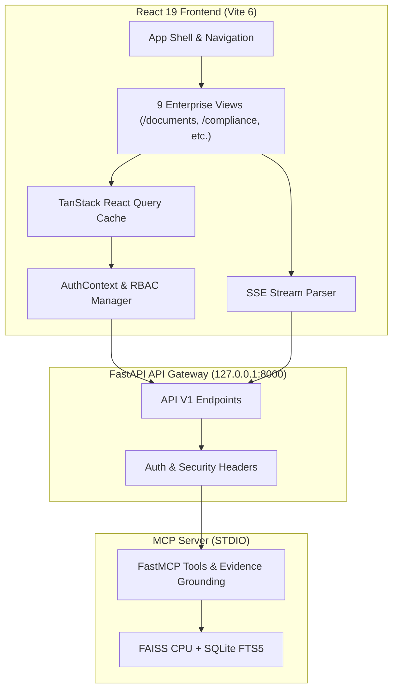

# VERITY Frontend Architecture & Component Blueprint

**Application:** VERITY – Enterprise Document Intelligence & Compliance Agent  
**Framework Version:** React 19.3.1 • Vite 6.2.0 • Tailwind CSS v4.3.4  
**Date:** November 2026  
**Status:** Production Ready & Verified

---

## 1. Architectural Overview

The VERITY frontend is an enterprise-grade Single Page Application (SPA) designed to provide continuous compliance visibility, secure document ingestion, hybrid vector/keyword search, and real-time streaming conversational intelligence.

It operates entirely with local-first inference and zero cloud telemetry costs ($0.00), communicating with the local FastAPI backend (`http://127.0.0.1:8000`) and the FastMCP server over STDIO.



---

## 2. Directory Layout

```
frontend/
├── .env.example                     # Environment variables template
├── package.json                     # Dependencies & build scripts
├── vite.config.ts                   # Vite & Vitest configuration
├── tsconfig.json                    # TypeScript strict compiler options
└── src/
    ├── api/
    │   ├── client.ts                # Axios instance & security interceptors
    │   └── types.ts                 # Strongly typed backend API contracts
    ├── context/
    │   ├── AuthContext.tsx          # RBAC state & API key delegation
    │   └── ToastContext.tsx         # Notification queue with auto-dismiss
    ├── services/
    │   ├── healthService.ts         # /health and /ready diagnostic checks
    │   ├── documentService.ts       # Upload, pagination, and deletion
    │   ├── searchService.ts         # Hybrid RRF search querying
    │   ├── chatService.ts           # Standard & SSE streaming chat
    │   ├── complianceService.ts     # Matrix evaluation & gap analysis
    │   └── knowledgeService.ts      # Ontology nodes & backlinks
    ├── components/
    │   ├── common/                  # Badge, Button, Card, Modal, Spinner
    │   ├── layout/                  # Sidebar, Header, Breadcrumb, AppLayout
    │   ├── documents/               # UploadZone, DocumentTable, DocumentDetailModal
    │   ├── chat/                    # ChatMessage, CitationCard, ChatInput
    │   ├── compliance/              # CoverageChart, RequirementTable, FindingDrawer
    │   └── knowledge/               # GraphCanvas (SVG), NodeDetailDrawer
    ├── pages/                       # 9 dedicated enterprise route views
    └── test/                        # Vitest + Happy-DOM component test suites
```

---

## 3. Core Subsystems

### 3.1. Authentication & Role-Based Access Control (RBAC)

The `AuthContext` provides declarative role enforcement and dynamic `X-API-Key` assignment across three distinct roles:
1. **Admin (`verity-admin-secret-key`)**: Unrestricted access (document ingestion, permanent deletion, FAISS index maintenance, compliance evaluation).
2. **Auditor (`verity-auditor-secret-key`)**: Read-only oversight (document chunk inspection, compliance rationales, historical audit diffs).
3. **User (`verity-user-secret-key`)**: General exploration (hybrid search, AI Assistant Q&A).

### 3.2. Server-Sent Events (SSE) Streaming Pipeline

The AI Assistant conversational interface connects to `POST /api/v1/chat/stream` via a custom `ReadableStream` parser in `chatService.ts`:
- **Stage Updates (`event: status`)**: Displays live pipeline progress ("Routing intent...", "Running FastMCP tool...", "Validating citations...").
- **Tokens (`event: token`)**: Streams answer markdown incrementally without UI freezing.
- **Citations (`event: citation`)**: Dispatches structured, verifiable source citations linked to exact chunk locators.
- **Completion (`event: done`)**: Finalizes message state and ground truth assurance badge.

### 3.3. Lightweight SVG Knowledge Graph Visualization

Rather than loading heavyweight WebGL or canvas dependencies (e.g., Cytoscape, D3, Three.js) that consume excessive memory on 8 GB RAM machines, `GraphCanvas.tsx` utilizes pure SVG:
- Circular layout rendering focus nodes, forward links, and backlinks.
- Traversal depth controls (Levels 1–3).
- Responsive, interactive click-to-focus entity navigation.

---

## 4. Design Direction & Style Standards

- **Sidebar:** Dark charcoal/navy (`bg-slate-900`) with high-contrast active states.
- **Main Workspace:** Light neutral backdrop (`bg-slate-50`) with white card containers (`bg-white border-slate-200`).
- **Brand Identity:** **VERITY** in bold uppercase with blue shield icon and subtitle *Enterprise Document Intelligence & Compliance Agent*.
- **Metrics Clarification:** RRF scores are explicitly labeled as *relative rank indicators*, not calibrated probabilities. Remediation timelines are labeled as *engineering planning estimates*.

---

## 5. Verification & Testing

- **Engine:** Vitest 4.1.12 with Happy-DOM.
- **Test Suites:** Badge components, Button states, ChatMessage with verified citations, CoverageChart percentages, Sidebar routing, and AuthContext RBAC switching.
- **Bundle Verification:** Vite 6 production build compiles with zero TypeScript errors into optimized static bundles (`dist/`).

