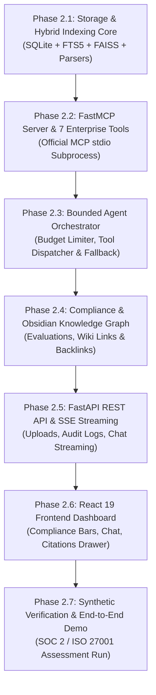

# VERITY: Implementation Roadmap & Technical Risk Matrix

**Project:** VERITY – Enterprise Document Intelligence & Compliance Agent  
**Document:** Prioritized Implementation Roadmap & Risk Assessment  
**Classification:** Technical Assessment Blueprint (Confidential)  
**Author:** Principal AI Architect & Senior Python Engineer  
**Date:** November 2026  

---

## 1. Prioritized Implementation Roadmap

The implementation is broken down into seven logically sequenced, verifiable sub-phases. Each phase produces working, testable code with continuous regression validation.

---

## 2. Phase Breakdown & Deliverables

### Phase 2.1: Storage & Hybrid Indexing Core
- **Objective:** Build database persistence, document parsers, and hybrid retrieval.
- **Key Deliverables:**
  - `src/storage/db.py`: SQLite schema initialization, connection management, FTS5 triggers.
  - `src/storage/faiss_store.py`: FAISS CPU vector index wrapper with vector persistence.
  - `src/parsers/`: Document extractors for `.pdf` (PyMuPDF), `.docx` (python-docx), and `.txt`.
  - `src/indexing/hybrid_search.py`: Reciprocal Rank Fusion (RRF) combining dense and lexical search.
- **Verification:** Unit tests confirming chunking, deduplication, and hybrid retrieval accuracy.

### Phase 2.2: FastMCP Server & 7 Enterprise Tools
- **Objective:** Implement the official Model Context Protocol server exposing the compliance tool suite.
- **Key Deliverables:**
  - `src/mcp_server/server.py`: FastMCP server entry point running over `stdio`.
  - `src/mcp_server/tools/`: Implementations for:
    1. `list_documents`
    2. `search_documents`
    3. `get_document_metadata`
    4. `get_citation`
    5. `evaluate_compliance`
    6. `gap_analysis`
    7. `get_related_knowledge`
- **Verification:** Protocol test executing JSON-RPC handshakes and tool executions over stdio pipes.

### Phase 2.3: Bounded Agent Orchestrator & Client Integration
- **Objective:** Build the bounded agent loop with MCP client session management.
- **Key Deliverables:**
  - `src/agent/orchestrator.py`: Bounded FSM agent with $\le 5$ tool call budget limiter.
  - `src/agent/mcp_client.py`: Official MCP Python SDK stdio client session manager.
  - `src/agent/fallback.py`: Deterministic fallback engine for LLM-offline operation.
- **Verification:** Mock test verifying tool budget enforcement, allowlist rejection, and fallback triggering.

### Phase 2.4: Compliance & Obsidian Knowledge Graph
- **Objective:** Implement regulatory evaluation logic and Obsidian-inspired linking.
- **Key Deliverables:**
  - `src/compliance/engine.py`: `COVERED`, `PARTIALLY_COVERED`, `MISSING` evaluation with mandatory evidence validation.
  - `src/knowledge/graph.py`: Wiki-link regex parser (`[[Link]]`), note generator, and backlink resolver in SQLite.
- **Verification:** Test verifying zero coverage without citation and bi-directional backlink queries.

### Phase 2.5: FastAPI REST API & SSE Streaming Gateway
- **Objective:** Expose high-performance asynchronous REST endpoints and streaming chat.
- **Key Deliverables:**
  - `src/api/routes/documents.py`: Document upload, list, metadata endpoints.
  - `src/api/routes/compliance.py`: Compliance audit, gap analysis, and framework endpoints.
  - `src/api/routes/chat.py`: Server-Sent Events (SSE) streaming endpoint for live agent thoughts and tool traces.
- **Verification:** Async HTTP integration tests via `httpx.AsyncClient`.

### Phase 2.6: React 19 Frontend Dashboard
- **Objective:** Deliver interactive, responsive dashboard for live demonstration.
- **Key Deliverables:**
  - Compliance Dashboard view with Recharts framework coverage charts and gap tables.
  - Interactive Agent Chat view with streaming thought bubbles, tool call pills, and citation cards.
  - Document Repository view with upload dropzone and SHA-256 verification display.
  - Knowledge Graph view displaying backlinks and concept relationships.
- **Verification:** Full production build and component render tests.

### Phase 2.7: Synthetic Verification & Assessment Run
- **Objective:** Validate end-to-end user workflows using synthetic enterprise policies.
- **Key Deliverables:**
  - Synthetic dataset: Sample Information Security Policy, Cloud Access Control SOP, and Disaster Recovery Plan.
  - Automated evaluation harness demonstrating genuine MCP execution and 100% citation grounding.
  - Final assessment demonstration rehearsal.

---

## 3. Technical Risk Matrix & Mitigation Strategies

| Risk ID | Technical Risk Description | Severity | Likelihood | Mitigation Strategy |
| :---: | :--- | :---: | :---: | :--- |
| **TR-1** | **Memory Exhaustion (8 GB Host RAM Limit):** PyTorch, Sentence-Transformers, and Ollama competing for memory causing OS disk swapping. | High | Medium | Standardize on lightweight `all-MiniLM-L6-v2` (80MB) and `qwen2.5:1.5b` (986MB). Load models lazily, run FAISS in flat CPU mode, and exclude heavy JVM databases like Neo4j. |
| **TR-2** | **stdio Pipe Deadlocks in MCP Subprocess:** Asynchronous buffer blocking during large document payloads over Windows stdio pipes. | High | Low | Enforce chunked streaming in FastMCP, set bounded max token output in tools, and configure strict 8.0s execution timeouts on client calls. |
| **TR-3** | **LLM Hallucination of Regulatory Clauses:** Model generating false ISO/SOC 2 requirements or claiming coverage without real policy text. | Critical | Medium | Implement the **Mandatory Evidence Rule** in the compliance engine: schema validator rejects `COVERED` status unless backed by verified chunk hash. Enforce strict XML containment prompts. |
| **TR-4** | **Windows Path Formatting & Encoding Bugs:** File path delimiters and Windows cmd quoting issues (e.g., paths containing `&`). | Medium | Low | Standardize on `pathlib.Path` with POSIX/forward-slash normalization and pass paths via direct Node/Python arguments rather than string shell interpolation. |
| **TR-5** | **Agent Infinite Reasoning Loops:** Agent calling tools repeatedly without converging on an answer. | Medium | Low | Enforce strict **Bounded Budget Controller** ($\le 5$ tool calls max per user turn). Once budget is exhausted, immediately force response synthesis. |
| **TR-6** | **Local LLM Daemon Downtime:** Ollama process stopped or unresponsive during technical demonstration. | Medium | Low | Maintain the **Deterministic Fallback Engine** that detects offline Ollama and formats direct MCP tool outputs with explicit status tags. |

