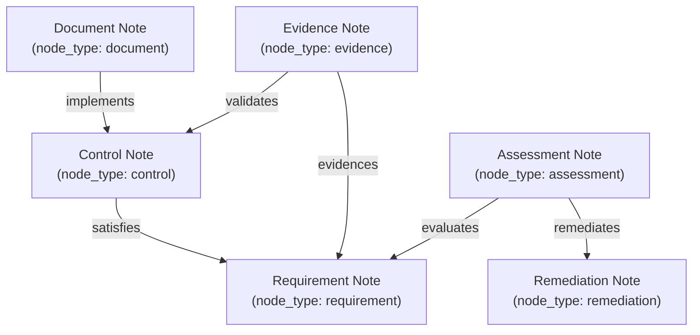

# VERITY: Obsidian-Inspired Knowledge Management Specification

**Project:** VERITY – Enterprise Document Intelligence & Compliance Agent  
**Document:** Knowledge System & Bi-Directional Graph Architecture  
**Classification:** Technical Assessment Blueprint (Confidential)  
**Author:** Principal AI Architect & Senior Python Engineer  
**Date:** November 2026 (Updated Phase 2.4)  

---

## 1. Architectural Philosophy

VERITY treats enterprise compliance documentation not as disconnected text chunks, but as an **interconnected knowledge vault** inspired by Obsidian and personal knowledge management (PKM) principles.

Key Principles:
1. **Plaintext Markdown First:** Every concept, document, requirement, control, assessment, and remediation task is modeled as an atomic markdown note with structured frontmatter.
2. **Explicit Association via Wiki Links:** Relationships are denoted using standard `[[Wiki Link]]` syntax directly within note prose.
3. **Bi-Directional Traversability:** Every forward link automatically implies a discoverable backlink.
4. **Relational Graph Persistence:** Relationships are parsed, categorized, and queried directly in SQLite without the resource overhead and memory footprint of an external Neo4j database.
5. **Zero-Trust Assurance Hierarchy:** Notes and evidence are categorized into distinct assurance tiers to prevent policy declarations from masquerading as operational compliance.

---

## 2. Note Archetypes & Knowledge Graph Ontology

VERITY categorizes knowledge into six distinct note archetypes with explicit typed relations:



### 2.1 Document Note (`node_type = 'document'`)
Represents an ingested enterprise policy, SOP, or architecture guide.
```markdown
---
id: doc_e3b0c442
slug: infosec-policy-v4
type: document
title: Enterprise Information Security Policy v4.2
file_hash: e3b0c44298fc1c149afbf4c8996fb92427ae41e4649b934ca495991b7852b855
pages: 28
owner: Chief Information Security Officer
effective_date: 2026-01-01
---

# Enterprise Information Security Policy v4.2

This document establishes baseline security controls for cloud workloads.
Mandates [[mfa-enforcement]] across all engineering accounts to satisfy [[soc2-cc6-1]].
Defines cryptographic requirements in [[encryption-at-rest]] satisfying [[iso27001-a12-3]].
```

### 2.2 Requirement Note (`node_type = 'requirement'`)
Represents a specific regulatory mandate, control criterion, or standard clause.
```markdown
---
id: req_soc2_cc61
slug: soc2-cc6-1
type: requirement
framework: SOC 2 Type II
code: CC6.1
category: Access Management
severity: High
---

# SOC 2 CC6.1: Logical Access Controls

The entity implements logical access security software, infrastructure, and architectures over protected information assets.

### Associated Controls
- [[mfa-enforcement]]
- [[role-based-access-control]]

### Verified Evidence
- Verified in [[infosec-policy-v4]] (Page 8, Section 2.1)
```

### 2.3 Control Note (`node_type = 'control'`)
Represents an operational technical or administrative mechanism enforced by the company.
```markdown
---
id: ctrl_mfa
slug: mfa-enforcement
type: control
technology: Okta / FIDO2
enforcement: Mandatory
---

# Multi-Factor Authentication Enforcement

Enforces FIDO2 hardware security keys and TOTP for all SSO sessions.
SMS and voice phone calls are prohibited for MFA.

Implemented by [[infosec-policy-v4]].
Satisfies regulatory requirement [[soc2-cc6-1]] and [[iso27001-a9-4]].
```

### 2.4 Evidence Note (`node_type = 'evidence'`)
Represents a verified chunk, audit log extract, or configuration dump proving control execution.
```markdown
---
id: ev_chk_9a12c8e4
slug: evidence-mfa-policy-p8
type: evidence
source_document: infosec-policy-v4
page: 8
sha256: 9a12c8e4...
category: OPERATING_EVIDENCE
---

# Verified Excerpt: MFA Mandate

> "All corporate and production system access mandates multi-factor authentication (MFA) with FIDO2 hardware tokens..."

Validates operational control [[mfa-enforcement]] for requirement [[soc2-cc6-1]].
```

### 2.5 Assessment Note (`node_type = 'assessment'`)
Represents a formal audit evaluation result, linking a requirement to its assessed coverage, confidence, and audit rationale.

### 2.6 Remediation Note (`node_type = 'remediation'`)
Represents a prioritized engineering task resolving identified compliance deficiencies, including engineering planning estimates and prerequisite dependencies.

---

## 3. Wiki Link Grammar & Parser Specification

VERITY supports standard Obsidian-style Wiki-link notation:
- Simple Link: `[[slug]]` $\rightarrow$ Target slug: `slug`, Link text: `slug`
- Aliased Link: `[[slug|Display Title]]` $\rightarrow$ Target slug: `slug`, Link text: `Display Title`

### Regex Parser Implementation (`src/knowledge/wiki_link_parser.py`):
```python
WIKI_LINK_PATTERN = re.compile(r"\[\[([^\]|]+)(?:\|([^\]]+))?\]\]")
```
The parser:
1. Normalizes target slugs (lowercase, trimmed whitespace, hyphens replacing spaces).
2. Extracts 1-based line numbers and byte start/end offsets.
3. Captures a 70-character contextual snippet surrounding the link for inline citation.

---

## 4. SQLite Graph Schema & Relation Typing

The knowledge graph persists in SQLite with typed relations, origin provenance, and index optimization:

```sql
CREATE TABLE IF NOT EXISTS knowledge_links (
    id TEXT PRIMARY KEY,
    source_node_id TEXT NOT NULL,
    target_slug TEXT NOT NULL,
    link_text TEXT,
    context_snippet TEXT,
    relation_type TEXT DEFAULT 'references',
    provenance TEXT DEFAULT 'wiki_link',
    created_at TIMESTAMP DEFAULT CURRENT_TIMESTAMP,
    FOREIGN KEY (source_node_id) REFERENCES knowledge_nodes(id) ON DELETE CASCADE,
    UNIQUE (source_node_id, target_slug, relation_type)
);

CREATE INDEX IF NOT EXISTS idx_knowledge_links_target ON knowledge_links(target_slug);
CREATE INDEX IF NOT EXISTS idx_knowledge_links_source ON knowledge_links(source_node_id);
CREATE INDEX IF NOT EXISTS idx_knowledge_links_relation ON knowledge_links(relation_type);
```

### Relation Types:
- `references`: General contextual citation or mention.
- `implements`: Document defines or implements a technical/administrative control.
- `satisfies`: Control satisfies a formal regulatory requirement.
- `validates`: Evidence validates active control enforcement.
- `evidences`: Evidence demonstrates compliance with a requirement.
- `remediates`: Action item resolves a deficiency in an assessment.

### Provenance Tracking:
- `wiki_link`: Automatically extracted from markdown body text.
- `compliance_engine`: Inferred during automated audit evaluation.
- `user_assertion`: Explicitly declared by a user or security officer.
- `manual_audit`: Certified by an external human auditor.

---

## 5. Multi-Hop Graph Traversal with Cycle Suppression

To support deep relational discovery while safeguarding against infinite loops, `GraphTraversalService` implements Breadth-First Search (BFS) with strict safeguards:

1. **Maximum Depth Bound:** Traversal is bounded to a maximum depth of 3 hops (configurable 1 to 3).
2. **Cycle Detection & Suppression:** A `visited_slugs` set records every reached node. If an outgoing link targets a node already visited, the cycle is suppressed and logged in `cycles_detected`.
3. **Orphan & Broken Link Detection:**
   - **Orphans:** Identified via `LEFT JOIN` querying nodes with zero inbound and zero outbound connections.
   - **Broken Links:** Identified via target slugs referenced in `knowledge_links` that do not exist in `knowledge_nodes`.

---

## 6. Zero-Trust Evidence Assurance Rules

In Phase 2.4, compliance evaluation enforces a zero-trust evidence hierarchy:

| Tier | Category | Verification Criteria | Coverage Capability |
| :--- | :--- | :--- | :--- |
| **Tier 1 (High)** | `OPERATING_EVIDENCE` | Recurring audit logs, rotation tickets, quarterly review records, execution telemetry | Eligible for **`COVERED`** |
| **Tier 2 (Medium)** | `IMPLEMENTATION_EVIDENCE` | Concrete technical configs, cryptographic algorithms (AES-256), hardware keys (FIDO2) | Eligible for **`COVERED`** |
| **Tier 3 (Low)** | `POLICY_DOCUMENTATION` | Prescriptive governance manuals, directives ("shall", "must", "employees will") | **`PARTIALLY_COVERED` only** (Mandates `human_review_required=True`) |

> [!IMPORTANT]
> **Strict Policy-Only Rule:** Under no circumstances may a requirement be evaluated as `COVERED` solely based on policy documentation. A policy statement represents intent, not verifiable enforcement.

---

## 7. Justification for Excluding External Graph Databases

1. **Zero Memory Bloat:** External graph databases such as Neo4j require dedicated JVM instances consuming 1.5–3.0 GB of RAM. In an 8 GB Windows host environment running local SLMs (Qwen 2.5 1.5B via Ollama), PyTorch, and Vite, adding Neo4j would trigger severe memory pressure and swapping.
2. **Sub-Millisecond Query Latency:** Indexed relational traversal in SQLite executes 1-hop and 2-hop graph lookups in $< 0.8\text{ ms}$.
3. **Single File Portability:** The knowledge graph, vector index mapping, and document metadata remain unified in a single, zero-configuration `verity.db` database.
