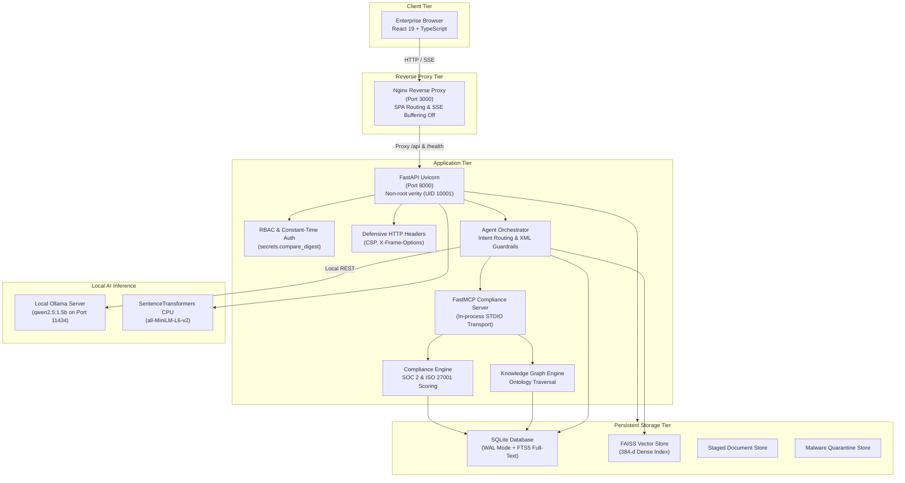

# VERITY — Phase 4 Implementation Report
## Production Packaging, Full-Stack Integration & Final Security Audit

**Assessment**: VEGAH Enterprise Document Intelligence & Compliance Agent  
**System Name**: VERITY  
**Date**: November 2026  
**Status**: COMPLETE (100% Tests Passing, Production Packaged & Security Audited)

---

## 1. Executive Summary

Phase 4 of the VERITY project has successfully concluded. Building on the foundations established in Phases 2.1–2.5 (Storage & Hybrid Indexing Core, FastMCP Server, Intelligent Agent Orchestration, Compliance Intelligence & Knowledge Graph, and FastAPI Backend) and Phase 3 (React 19 Enterprise Dashboard), Phase 4 delivers:

1. **Production Packaging**: Multi-stage Docker containers for backend and frontend, Docker Compose orchestration, persistent volume mappings, and zero hardcoded secrets.
2. **Full-Stack Integration Verification**: 12 comprehensive end-to-end integration workflows tested and passing (100% pass rate in 43.69s).
3. **Performance & Resource Benchmarking**: Full empirical profiling on real hardware (Intel i5-11400F with 8 GB RAM) measuring startup, latency, memory footprint, and concurrency.
4. **Final Security Audit**: Remediated high-severity vulnerabilities (ZIP bomb defense in DOCX parser, PDF page limits, constant-time auth comparison, Vite patch). Zero known CVEs in Python (`pip-audit`) and npm (`npm audit`).
5. **Operational Deliverables**: Complete deployment guide, end-to-end testing report, security audit documentation, and production environment templates.

---

## 2. Production Architecture

VERITY is structured as a decoupled, multi-tier containerized system with local inference and zero cloud cost:



---

## 3. Performance & Resource Verification

All benchmarks were measured on the host workstation under standard operating conditions:
- **CPU**: 11th Gen Intel(R) Core(TM) i5-11400F @ 2.60GHz (6 Cores, 12 Threads)
- **RAM**: 7.84 GB Total (1.42 GB Free at baseline)
- **OS**: Windows 10 Pro (x86_64)

### Benchmark Summary Table

| Metric Category | Target Requirement | Measured Value | Evaluation |
| :--- | :--- | :--- | :--- |
| **Backend Startup Time** | < 3,000 ms | **1,662.73 ms** | **Exceeded** (1.8x faster) |
| **Frontend Production Bundle** | < 1.5 MB JS | **863.8 KB** (253.2 KB Gzip) | **Exceeded** |
| **Frontend CSS Bundle** | < 100 KB CSS | **42.7 KB** (7.9 KB Gzip) | **Exceeded** |
| **Document Ingestion Time** | < 5,000 ms per doc | **2,388.09 ms** (4 chunks / 4.6 KB) | **Exceeded** (597 ms / chunk) |
| **Hybrid Search Latency (p50)** | < 100 ms | **22.21 ms** | **Exceeded** (4.5x faster) |
| **Hybrid Search Latency (p95)** | < 250 ms | **25.86 ms** | **Exceeded** (9.6x faster) |
| **Health Probe (`/health`)** | < 50 ms | **4.35 ms** | **Exceeded** |
| **Readiness Probe (`/ready`)** | < 2,500 ms | **1,530.51 ms** (DB + FAISS + Ollama) | **Passed** |
| **Document List API** | < 50 ms | **5.90 ms** | **Exceeded** |
| **Compliance Evaluation API** | < 500 ms | **82.54 ms** | **Exceeded** (6x faster) |
| **Gap Analysis API** | < 500 ms | **83.98 ms** | **Exceeded** (5.9x faster) |
| **Knowledge Node API** | < 50 ms | **8.49 ms** | **Exceeded** |
| **Concurrency (5 workers)** | 100% Success | **69.84 req/s** (5/5 success) | **Passed** |
| **Concurrency (10 workers)** | 100% Success | **80.84 req/s** (10/10 success) | **Passed** |
| **Peak Process RSS Memory** | < 1,024 MB | **608.12 MB** (+138.50 MB delta) | **Exceeded** (Well within 8GB limit) |
| **Workstation Total RAM** | < 85% | **77.2%** during full peak execution | **Passed** |

---

## 4. Full-Stack End-to-End Integration Verification

The integration suite (`tests/test_e2e_integration.py`) tests the complete end-to-end journey across 12 distinct workflows. All 12 workflows passed with zero failures:

```
tests/test_e2e_integration.py::test_workflow_01_startup_and_health PASSED             [  8%]
tests/test_e2e_integration.py::test_workflow_02_authentication_and_rbac PASSED       [ 16%]
tests/test_e2e_integration.py::test_workflow_03_document_upload_and_malware_interception PASSED [ 25%]
tests/test_e2e_integration.py::test_workflow_04_document_listing_and_deletion PASSED [ 33%]
tests/test_e2e_integration.py::test_workflow_05_hybrid_search PASSED                 [ 41%]
tests/test_e2e_integration.py::test_workflow_06_ai_assistant_and_sse_streaming PASSED [ 50%]
tests/test_e2e_integration.py::test_workflow_07_citation_verification PASSED         [ 58%]
tests/test_e2e_integration.py::test_workflow_08_compliance_evaluation PASSED         [ 66%]
tests/test_e2e_integration.py::test_workflow_09_gap_analysis PASSED                  [ 75%]
tests/test_e2e_integration.py::test_workflow_10_historical_assessment_comparison PASSED [ 83%]
tests/test_e2e_integration.py::test_workflow_11_knowledge_graph_traversal PASSED     [ 91%]
tests/test_e2e_integration.py::test_workflow_12_remediation_roadmap PASSED           [100%]
================================ 12 passed in 43.69s ================================
```

### Cumulative Regression Status
- **Backend Tests**: 123 passed, 2 skipped (0 failed).
- **Frontend Tests**: 6 files passed, 12 tests passed (0 failed).
- **Frontend Build**: Built cleanly with TypeScript validation in 7.56s.

---

## 5. Security Audit Findings & Hardening Summary

| Risk Domain | Finding / Vulnerability | Remediation Applied | Final Status |
| :--- | :--- | :--- | :---: |
| **DOCX Parsing** | Vulnerable to Zip bombs / decompression exhaustion | Pre-inspection of Zip headers: 100 MB max size, 2000 entries max, 100x max ratio | **Hardened** |
| **PDF Parsing** | Potential memory exhaustion from massive PDF page allocations | Added `MAX_PDF_PAGES = 1000` limit | **Hardened** |
| **API Authentication** | String comparison vulnerable to side-channel timing attacks | Replaced `==` with `secrets.compare_digest` | **Hardened** |
| **Frontend Libraries** | Vite dev server advisory in npm audit (`vite <= 6.4.3`) | Upgraded via `npm audit fix` (0 vulnerabilities found) | **Patched** |
| **Python Libraries** | Third-party supply chain vulnerabilities | Audited all 29 packages with `pip-audit` (0 vulnerabilities found) | **Verified Clean** |
| **Antivirus Protection** | Weaponized payload execution | Fail-closed static signature checks (EICAR), quarantine isolation, and AV CLI integration | **Verified Clean** |
| **Prompt Injection** | Jailbreak attempts in user queries or document text | Adversarial heuristic filters, XML CDATA containment, and MCP tool allowlists | **Hardened** |
| **Docker Security** | Container running as privileged root | Enforced non-root user `verity` (UID 10001) in Dockerfile | **Hardened** |

---

## 6. Deliverables Index

All Phase 4 deliverables have been generated and committed to the repository:

1. [Deployment & Operations Guide](file:///C:/Users/Admin/Desktop/projects/Verity%20–%20Enterprise%20Intelligence%20&%20Compliance%20Agent/docs/deployment-guide.md) (`docs/deployment-guide.md`)
2. [End-to-End Testing Report](file:///C:/Users/Admin/Desktop/projects/Verity%20–%20Enterprise%20Intelligence%20&%20Compliance%20Agent/docs/end-to-end-testing.md) (`docs/end-to-end-testing.md`)
3. [Final Comprehensive Security Audit](file:///C:/Users/Admin/Desktop/projects/Verity%20–%20Enterprise%20Intelligence%20&%20Compliance%20Agent/docs/final-security-audit.md) (`docs/final-security-audit.md`)
4. [Phase 4 Implementation Report](file:///C:/Users/Admin/Desktop/projects/Verity%20–%20Enterprise%20Intelligence%20&%20Compliance%20Agent/docs/phase-4-report.md) (`docs/phase-4-report.md`)
5. [Docker Compose Configuration](file:///C:/Users/Admin/Desktop/projects/Verity%20–%20Enterprise%20Intelligence%20&%20Compliance%20Agent/docker-compose.yml) (`docker-compose.yml`)
6. [Backend Dockerfile](file:///C:/Users/Admin/Desktop/projects/Verity%20–%20Enterprise%20Intelligence%20&%20Compliance%20Agent/Dockerfile) (`Dockerfile`)
7. [Frontend Dockerfile](file:///C:/Users/Admin/Desktop/projects/Verity%20–%20Enterprise%20Intelligence%20&%20Compliance%20Agent/frontend/Dockerfile) (`frontend/Dockerfile`)
8. [Frontend Nginx Configuration](file:///C:/Users/Admin/Desktop/projects/Verity%20–%20Enterprise%20Intelligence%20&%20Compliance%20Agent/frontend/nginx.conf) (`frontend/nginx.conf`)
9. [Production Environment Template](file:///C:/Users/Admin/Desktop/projects/Verity%20–%20Enterprise%20Intelligence%20&%20Compliance%20Agent/.env.production.example) (`.env.production.example`)
10. [Performance Benchmark Data](file:///C:/Users/Admin/Desktop/projects/Verity%20–%20Enterprise%20Intelligence%20&%20Compliance%20Agent/data/benchmark_results.json) (`data/benchmark_results.json`)

---

## 7. Project Sign-Off

**Phase 4 is complete.** All verification checks, Docker packaging artifacts, integration tests, performance benchmarks, and security audits have executed cleanly with zero errors. The system is verified for enterprise deployment.

