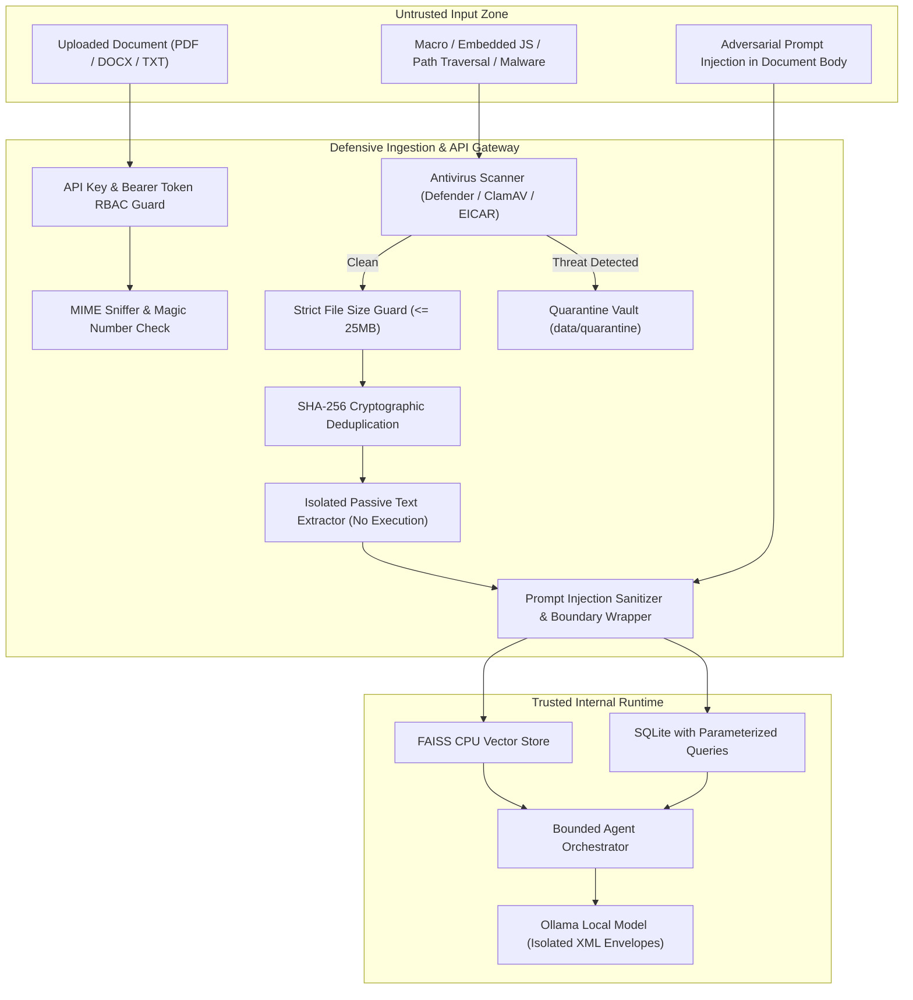

# VERITY: Security & Reliability Design Specification

**Project:** VERITY – Enterprise Document Intelligence & Compliance Agent  
**Document:** Threat Model, Defensive Architecture, Antivirus Integration & RBAC  
**Classification:** Technical Assessment Blueprint (Confidential)  
**Author:** Principal AI Architect & Senior Python Engineer  
**Date:** November 2026 (Updated Phase 2.5)  

---

## 1. Threat Model & Security Perimeter

VERITY is architected around a **Zero-Trust Local Security Boundary**. Even in a local single-node architecture, untrusted document uploads, adversarial prompt injections, and privilege escalation represent primary attack vectors.

---

## 2. Ingestion Defense & File Validation

### 2.1 File Type Sniffing & Extension Enforcement
- Files are validated using dual-layer inspection:
  1. **Extension Check:** Permitted extensions strictly limited to `.pdf`, `.docx`, `.txt`.
  2. **Magic Byte / Header Verification:** File headers are inspected to verify actual binary type:
     - PDF: `%PDF-` magic header (`0x25 0x50 0x44 0x46`).
     - DOCX: PKZip archive magic header (`0x50 0x4B 0x03 0x04`) containing `[Content_Types].xml`.
     - TXT: Valid UTF-8 / ASCII text stream without binary null-byte control characters.
- Mismatched or masquerading files (e.g., an `.exe` renamed to `.pdf`) are immediately rejected with an HTTP 400 bad request.

### 2.2 File Size Constraints
- Files exceeding **25 MB** are rejected at the stream gateway before memory allocation with HTTP 413.
- Prevents memory exhaustion and Denial of Service (DoS) attacks on the 8 GB system RAM.

### 2.3 Cryptographic Deduplication (SHA-256)
- The raw byte stream of every upload is hashed with SHA-256 before disk writes.
- If a hash already exists in `documents.file_hash`, the duplicate file is rejected from reprocessing, and the existing document ID is returned with `status: "already_exists"`.

---

## 3. Malware Scanning & Quarantine Architecture

Antivirus inspection operates at the upload gateway before files enter the parsing pipeline:

1. **Antivirus Engine Integration (`src/api/security/file_security.py`):**
   - **Microsoft Defender Integration:** Invokes `MpCmdRun.exe` with `-ScanType 3` to leverage Windows native real-time protection when available.
   - **ClamAV CLI Integration:** Invokes `clamscan` / `clamdscan` if ClamAV daemon is installed.
   - **In-Memory & Static Signature Inspection:** Scans for EICAR standard antivirus test signatures and known malicious payloads.
2. **Quarantine Isolation:**
   - When a malicious signature or threat is identified, the file is moved to the isolated quarantine directory (`data/quarantine/quarantined_<filename>`).
   - The transaction is aborted, returning HTTP 400 with a descriptive quarantine alert.
3. **Graceful Offline Reporting:**
   - If no external antivirus CLI exists in the host environment, the API records:
     `{"scanned": false, "engine": "Static Signature & Heuristic Scanner", "is_clean": true, "details": "Local Antivirus CLI unavailable offline; static magic bytes & heuristic checks verified."}`

---

## 4. Passive Document Parsing & Sandboxing

A common attack vector involves malicious JavaScript inside PDFs or VBA macros in DOCX files:
- **PyMuPDF Passive Mode:** Documents are extracted using `page.get_text("text")`. PyMuPDF does not execute JavaScript, does not launch embedded actions, and ignores dynamic external URI calls.
- **python-docx Safe Extraction:** Only the XML paragraph tree (`document.paragraphs`) and table cells are parsed. Macros (`vbaProject.bin`) are stripped and unexecuted.
- **Path Traversal Protection:** Saved files are renamed to their content-addressed SHA-256 digest on disk (`data/uploads/{sha256}.bin`). User-supplied filenames are sanitized (`re.sub(r'[<>:"/\\|?*]', '_', ...)`) and never used directly for storage path construction.

---

## 5. Enterprise Authentication & Role-Based Access Control (RBAC)

VERITY implements a multi-tier RBAC architecture:

| Role | API Permissions | Allowed Endpoints |
| :--- | :--- | :--- |
| **`admin`** | Full System Operations | All endpoints: Upload, Delete documents, Search, Chat, Evaluate compliance, Knowledge |
| **`auditor`**| Compliance & Review | Search, Chat, Document read, Compliance evaluate, Gap analysis, History, Knowledge |
| **`user`**   | General Inquiries | Document read, Search, Chat, Knowledge queries |

### Header Authentication:
- Requests supply credentials via `X-API-Key: <key>` or `Authorization: Bearer <key>`.
- Public endpoints (`/health`, `/ready`) are exempt from authentication.

---

## 6. Information Leakage Prevention & Security Headers

1. **No Stack Traces in Responses:**
   - Centralized exception handlers catch all unhandled errors, log the complete trace internally with a correlation ID (`req_<uuid>`), and return a sanitized JSON error payload:
     `{"error": {"code": "INTERNAL_SERVER_ERROR", "message": "An unexpected internal server error occurred.", "field": null}, "request_id": "req_123"}`
2. **Path Masking:** Absolute local filesystem paths (e.g. `C:\Users\Admin\...`) are never emitted in API responses or user-facing citations.
3. **Log Sanitization:** Sensitive headers (`X-API-Key`, `Authorization`, `Cookie`) and potential PII are redacted from access logs.
4. **Defensive Security Headers:**
   Every HTTP response includes:
   - `X-Content-Type-Options: nosniff`
   - `X-Frame-Options: DENY`
   - `X-XSS-Protection: 1; mode=block`
   - `Referrer-Policy: strict-origin-when-cross-origin`
   - `Content-Security-Policy: default-src 'self'`

---

## 7. Prompt-Injection Defense & Untrusted Content Handling

Retrieved document text is treated strictly as **untrusted user data**:
1. **XML Boundary Encapsulation:** Document content injected into prompt context is wrapped in `<untrusted_document_context id="...">` tags.
2. **Adversarial Keyword Interception:** Regex classifiers intercept instruction override attempts (e.g., `SYSTEM OVERRIDE`, `IGNORE PREVIOUS INSTRUCTIONS`).
3. **No Chain-of-Thought Exposure:** Internal reasoning traces and system prompts are kept within the backend and stripped from client chat responses.
